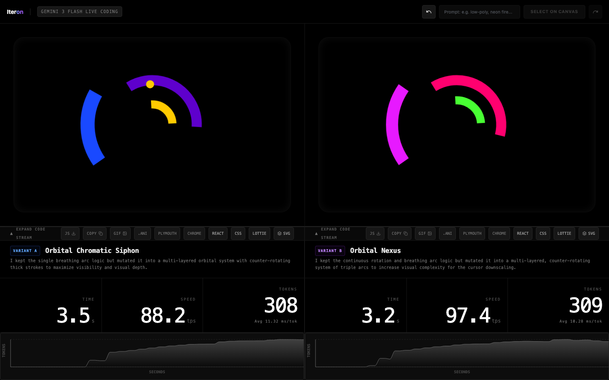
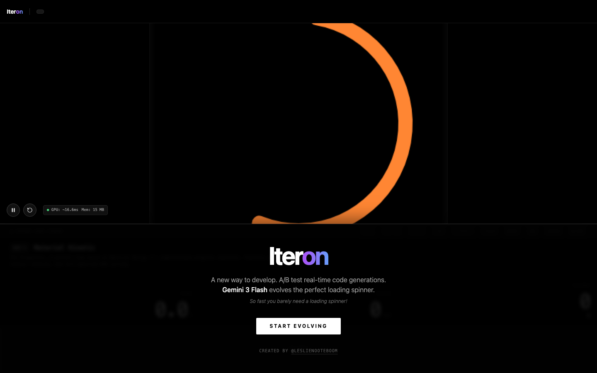
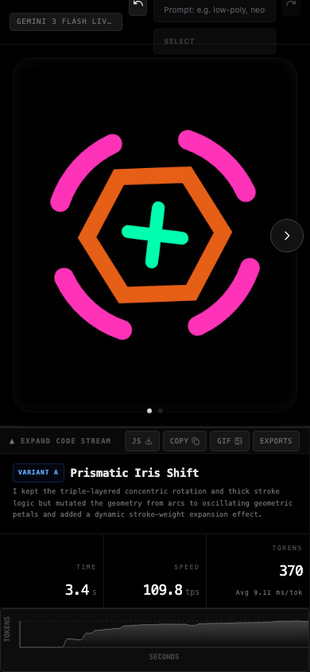

<div align="center">

<br />


<br /><br />

```
  ██╗████████╗███████╗██████╗  ██████╗ ███╗   ██╗
  ██║╚══██╔══╝██╔════╝██╔══██╗██╔═══██╗████╗  ██║
  ██║   ██║   █████╗  ██████╔╝██║   ██║██╔██╗ ██║
  ██║   ██║   ██╔══╝  ██╔══██╗██║   ██║██║╚██╗██║
  ██║   ██║   ███████╗██║  ██║╚██████╔╝██║ ╚████║
  ╚═╝   ╚═╝   ╚══════╝╚═╝  ╚═╝ ╚═════╝ ╚═╝  ╚═══╝
```

### **A new way to develop** — A/B test real-time code generations. Watch Gemini 3 Flash *evolve* the perfect loading spinner.

[Live Demo](https://iteron.vercel.app) · [Report Bug](https://github.com/kutluhangil/Iteron/issues) · [Request Feature](https://github.com/kutluhangil/Iteron/issues)

</div>

---

## 🇹🇷 Türkçe Açıklama

**Iteron**, yapay zekânın kod üretimini gerçek zamanlı izleyebileceğiniz, üretken (generative) bir geliştirme oyun alanıdır. Her tur **iki aday** (A/B) üretir — beğendiğinizi seçersiniz, o aday bir sonraki neslin **ebeveyni** olur. Gemini 3 Flash, p5.js loading spinner'larını canlı akış (streaming) ile üretir; mantığın **%80'ini korur, %20'sini mutasyona uğratır** ve böylece sürekli evrilen bir tasarım soyağacı oluşur.

Spinner'ı mikrofonla **sese tepki verir** hale getirebilir, hızını/renk tonunu canlı ayarlayabilir, sonucu **React / CSS / Lottie** koduna dönüştürebilir veya **Windows · Linux · Chrome** için hazır animasyonlu imleç paketleri olarak indirebilirsiniz. Beğendiğiniz tasarımları Firebase tabanlı topluluk galerisinde paylaşabilirsiniz.

---

## ✦ What is Iteron?

**Iteron** turns AI code generation into a live, visual, evolutionary loop. Instead of asking a model for one answer, you breed answers.

Every iteration spawns **two AI candidates side-by-side**. You pick the winner. That winner becomes the seed of the next generation — keeping its lineage while mutating just enough to stay surprising. The result is a genealogical tree of p5.js loading spinners, each streamed token-by-token in front of you with live tokens/sec telemetry.

When you find one you love, ship it: convert it to **React, CSS, or Lottie**, or export it as a real **animated OS cursor** for Windows, Linux, or Chrome.

No prompt-and-pray. Just generate, compare, evolve.

---

## ⚡ Features

| Feature | Description |
|--------|-------------|
| 🧬 **A/B Evolution** | Each round generates two candidates — pick a winner, it parents the next generation (80% lineage · 20% mutation) |
| ⚡ **Live Streaming** | Watch Gemini 3 Flash write p5.js code in real time, with per-generation **tokens/sec** telemetry |
| 📊 **TPS Stats Chart** | Recharts-powered timeline of generation speed and token throughput |
| 🌳 **Evolution Tree** | Visualize the full lineage of every mutation and jump back to any ancestor |
| 🎙️ **Audio-Reactive** | Toggle the microphone to make spinners pulse and react to live sound input |
| 🎛️ **Live Controls** | Adjust animation speed, hue shift, aspect ratio, play/pause, and light/dark theme on the fly |
| 🌱 **Custom Seed** | Paste your own p5.js sketch and evolve mutations from it |
| 📝 **Prompt Override** | Steer evolution with natural-language instructions for any iteration |
| 🔁 **Multi-Format Export** | One-click convert any spinner to **React + Tailwind**, **pure CSS keyframes**, or **Lottie JSON** |
| 🖱️ **OS Cursor Packs** | Export ready-to-install animated cursors: Windows `.ani` frames · Linux Plymouth theme · Chrome extension |
| 🖼️ **Community Gallery** | Sign in with Google, publish spinners, and like the community's best (Firebase Firestore) |
| ↩️ **Undo / Redo** | Scrub through your full generation history with synced timeline navigation |

---

## 🖼️ Screenshots

<div align="center">



**A/B Live Coding** — Gemini 3 Flash streams two candidate spinners side-by-side, each with live tokens/sec, generation time, and a TPS history chart. Pick a winner to seed the next generation.

<br />

| | |
|:---:|:---:|
|  |  |
| **Landing** — Hero with the live Progenitor spinner | **Mobile** — Swipeable single-variant layout |

</div>

---

## 🛠️ Tech Stack

```
Frontend     →  React 19 · TypeScript · Vite 6 · TailwindCSS (CDN)
Generative   →  p5.js 1.9 (instance mode) · p5.sound · p5.js-svg
AI           →  Google Gemini via @google/genai
                  · gemini-3-flash-preview  (streaming spinner generation)
                  · gemini-2.5-pro          (React / CSS / Lottie conversion)
Data & Auth  →  Firebase 12 — Google Auth · Firestore (community gallery)
Editor       →  react-simple-code-editor · Prism.js · Monaco Editor
Charts/Viz   →  Recharts · D3
Export       →  JSZip · file-saver (cursor packs)
Icons        →  Lucide React
Deployment   →  Vercel (SPA · static dist)
```

---

## 🚀 Getting Started

### Prerequisites

- Node.js `>= 18`
- A [Gemini API key](https://aistudio.google.com/app/apikey) (free)
- *(Optional)* A Firebase project with **Google Auth** + **Firestore** enabled — only needed for the community gallery

### Local Development

```bash
# Clone the repository
git clone https://github.com/kutluhangil/Iteron.git
cd Iteron

# Install dependencies
npm install

# Configure environment
# Create a .env.local in the project root (see below)

# Start the dev server (runs on http://localhost:3000)
npm run dev
```

### Environment Variables

Iteron needs a single key. Vite maps `GEMINI_API_KEY` to both `process.env.API_KEY` and `process.env.GEMINI_API_KEY` at build time (see `vite.config.ts`).

| Variable | Description | Required |
|----------|-------------|----------|
| `GEMINI_API_KEY` | Google Gemini API key — powers generation & format conversion | ✅ |

Create a `.env.local` in the project root:

```env
GEMINI_API_KEY=your_gemini_key_here
```

> Never commit `.env.local` — it's already in `.gitignore`.

**Firebase (optional):** the community gallery reads its credentials from `firebase-applet-config.json`. Swap in your own Firebase project's web config to enable Google sign-in, publishing, and likes. Firestore access is locked down by `firestore.rules` — spinners are publicly readable, but only authenticated users can create them, and likes can only ever increment by one.

---

## ☁️ Deployment

Iteron is a static Vite build and deploys to **Vercel** out of the box.

1. Push your code to a GitHub repository
2. Go to [vercel.com/new](https://vercel.com/new) and import the repo
3. Add `GEMINI_API_KEY` under **Settings → Environment Variables**
4. Click **Deploy** — that's it

`vercel.json` already wires up the build (`npm run build` → `dist`) and SPA rewrites so every route falls back to `index.html`. You get an instant global CDN, automatic HTTPS, and preview deployments on every PR.

---

## 📐 Project Structure

```
Iteron/
├── App.tsx                     # Root app — A/B loop, controls, history, export UI
├── index.tsx                   # React 19 entry point
├── types.ts                    # SpinnerData, CandidateState, GenerationStats
├── components/
│   ├── P5Canvas.tsx            # Renders a p5.js sketch in instance mode
│   ├── Terminal.tsx            # Streaming JSON terminal + partial-JSON parser
│   ├── StatsChart.tsx          # Recharts tokens/sec telemetry
│   ├── TreeVisualizer.tsx      # Mutation lineage tree
│   ├── ExploreGallery.tsx      # Firebase community gallery
│   └── ErrorBoundary.tsx       # Sandbox for AI-generated code
├── services/
│   └── geminiService.ts        # Gemini generation + format conversion
├── utils/
│   ├── exportService.ts        # Ghost-p5 frame capture → cursor ZIP packs
│   └── sound.ts                # UI sound effects
├── firebaseConfig.ts           # Firebase init (Auth + Firestore)
├── firestore.rules             # Security rules for the spinners collection
├── firebase-applet-config.json # Firebase web config (swap in your own)
└── vite.config.ts              # Vite + env-var injection
```

---

## 🔌 Core Services

| Service | Purpose |
|---------|---------|
| **`services/geminiService.ts`** | `generateNextSpinner()` streams p5.js code from `gemini-3-flash-preview` under a strict JSON schema; `convertSpinnerFormat()` translates a sketch to React / CSS / Lottie via `gemini-2.5-pro` |
| **`utils/exportService.ts`** | Spins up a hidden ("ghost") p5 instance, captures perfect loop frames, downscales them, and zips platform-ready cursor packs (Windows · Linux Plymouth · Chrome) |
| **`firebaseConfig.ts`** | Initializes Firebase, Google sign-in, and the Firestore client for the gallery |
| **`firestore.rules`** | Validates every published spinner and constrains likes to single increments |

---

## 📊 How It Works

### The Evolution Loop
1. The **Progenitor** (Gen 1) is a hand-tuned Material Design 3 progress indicator
2. Each round, Gemini streams **two candidates** (A & B) against a strict JSON schema (`mutationName`, `reasoning`, `p5Code`)
3. You pick a winner — it becomes the **parent** of the next generation
4. The system prompt instructs the model to keep **80% of the lineage** and mutate **20%** for controlled creativity
5. Every node is recorded in the **evolution tree**, so you can branch from any ancestor

### Live Telemetry
Generation is streamed chunk-by-chunk. Iteron measures elapsed time, estimates tokens (~4 chars/token), and renders a live **tokens/sec** chart — so you can literally watch how fast the model thinks.

### Export Pipeline
For OS cursors, Iteron renders your spinner in an off-screen p5 instance, advances time manually to capture a **seamless loop**, downscales each frame to cursor size (32–64px), and packages everything — frames, install scripts, and instructions — into a downloadable ZIP.

---

## 🗺️ Roadmap

| Status | Feature |
|:-:|---|
| ✅ | Real-time A/B spinner evolution |
| ✅ | Streaming generation with tokens/sec telemetry |
| ✅ | Evolution tree & history scrubbing |
| ✅ | Audio-reactive (microphone) mode |
| ✅ | React / CSS / Lottie conversion |
| ✅ | Windows · Linux · Chrome cursor export packs |
| ✅ | Firebase community gallery |
| 🔄 | Real token counts from the API (replace char estimate) |
| 🔄 | Shareable permalink per spinner |
| ○ | SVG & animated GIF export |
| ○ | Gallery search, tags & collections |
| ○ | Multi-model A/B (compare different models head-to-head) |

<sub>✅ Shipped &nbsp; · &nbsp; 🔄 In progress &nbsp; · &nbsp; ○ Planned</sub>

---

## 🤝 Contributing

Contributions are welcome! Feel free to open an issue or submit a pull request.

1. Fork the repository
2. Create your feature branch (`git checkout -b feature/amazing-feature`)
3. Commit your changes (`git commit -m 'feat: add amazing feature'`)
4. Push to the branch (`git push origin feature/amazing-feature`)
5. Open a Pull Request

---

## 📄 License

Source files are released under the **Apache License 2.0** (see the `SPDX-License-Identifier` headers in the source).

---

<div align="center">

<br />

Built with ❤️ by [**Kutluhan Gil**](https://github.com/kutluhangil)

<br />

*If you find this useful, consider giving it a ⭐*

<br />

</div>
