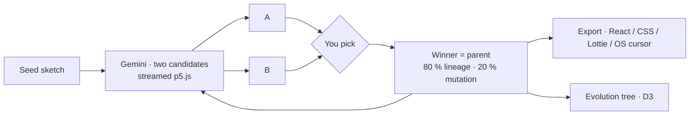

<div align="center">



<p>
  <a href="https://iteron.vercel.app"></a>
  
  
  
</p>

<p><em>AI code generation as a live, visual, evolutionary loop.<br>
Instead of asking a model for one answer, you breed answers.</em></p>

<a href="https://iteron.vercel.app"></a>

</div>


## How it works

Every round spawns **two candidates side by side**. You pick the winner, and it seeds the next generation, keeping its lineage while mutating just enough to stay surprising (80 % lineage, 20 % mutation). When you find one you love, ship it as React, CSS or Lottie, or as a real animated cursor for Windows, Linux or Chrome.




## Features

| | |
|---|---|
| **A/B evolution** | Two candidates per round; the winner parents the next. |
| **Live streaming** | Watch the model write p5.js in real time, with tokens-per-second telemetry. |
| **Speed chart** | A timeline of generation speed and throughput. |
| **Evolution tree** | The full lineage of every mutation; jump back to any ancestor. |
| **Audio reactive** | Turn on the microphone and the spinners pulse with sound. |
| **Live controls** | Speed, hue, aspect ratio, play / pause and theme on the fly. |
| **Custom seed and prompts** | Paste your own sketch and steer any round in plain language. |
| **Export** | React, CSS, Lottie, or a zipped animated cursor pack. |


## Türkçe özet

**Iteron**, yapay zekânın kod üretimini canlı izleyebildiğin evrimsel bir geliştirme oyun alanı. Her turda iki aday üretiliyor; beğendiğini seçiyorsun, o aday bir sonraki neslin ebeveyni oluyor. Gemini'nin p5.js kodunu gerçek zamanlı yazışını, saniyedeki token hızını ve tüm soy ağacını görebiliyorsun. Sonucu React, CSS ya da Lottie koduna çevirebilir veya Windows, Linux ve Chrome için animasyonlu imleç olarak indirebilirsin.


## Development

```sh
npm install
echo "GEMINI_API_KEY=..." > .env.local
npm run dev
npm run build
```

<div align="center">
<br>
<a href="https://github.com/kutluhangil"></a>
<sub>Generate. Compare. Evolve.</sub>
</div>
